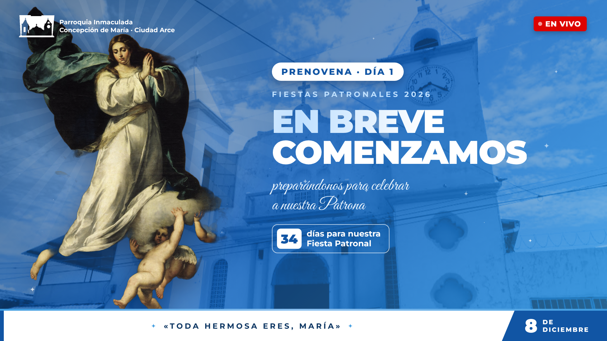

# Parroquia OBS · Inmaculada Concepción de María, Ciudad Arce

Pantallas, rótulos y panel de control para las transmisiones en vivo con **OBS Studio (Windows)**:
misas dominicales, misas de otros santos, prenovena, novena y la Misa Patronal del **8 de diciembre**.

Todo funciona **dentro de OBS**, sin internet, sin websockets y sin plugins: son archivos HTML locales
cargados como *fuentes de navegador* y un *dock de navegador personalizado* que hace de panel de control.



## Qué hay en el repositorio

| Carpeta / archivo | Para qué sirve |
|---|---|
| `obs/panel.html` | Panel de control (dock de OBS). Pestañas **En vivo · Preparar · Avisos · Textos**. |
| `obs/pantalla.html?tipo=…` | Pantallas completas: `inicio`, `portada`, `gracias`, `avisos`. |
| `obs/rotulos.html` | Capa transparente sobre la cámara: logo, EN VIVO, barra del título y rótulos animados. |
| `obs/comun.js` | Estado compartido, textos automáticos y utilidades (lo usan todas las páginas). |
| `obs/estilos.css` | Diseño y animaciones. |
| `obs/img/`, `obs/fuentes/` | Imágenes (Virgen A/B/C, fachada, logos) y tipografías locales. |
| `obs/LEEME - Instrucciones.txt` | Instalación paso a paso en OBS (para el equipo de transmisión). |
| `transiciones/` | Transiciones Stinger `.webm` con transparencia (2000 ms, punto de transición 1000 ms). |
| `herramientas/transiciones/` | Plantillas y script para volver a generar las transiciones. |
| `pruebas/prueba.js` | Prueba automática del panel y las pantallas. |
| `CLAUDE.md` | Contexto del proyecto para Claude Code. |
| `PROMPT_PARA_CLAUDE.md` | Prompt para empezar a trabajar con Claude Code en este repositorio. |

## Instalación rápida en OBS

1. Clone o copie el repositorio, por ejemplo en `C:\parroquia-obs`.
2. **Docks → Docks de navegador personalizados**: nombre `Panel Parroquia`, URL
   `file:///C:/parroquia-obs/obs/panel.html`
3. En cada escena, **Fuente → Navegador**, *sin* marcar «Archivo local», **1920 × 1080**:

   | Escena | URL |
   |---|---|
   | Inicio | `file:///C:/parroquia-obs/obs/pantalla.html?tipo=inicio` |
   | Portada 8 de diciembre | `file:///C:/parroquia-obs/obs/pantalla.html?tipo=portada` |
   | Avisos | `file:///C:/parroquia-obs/obs/pantalla.html?tipo=avisos` |
   | Gracias | `file:///C:/parroquia-obs/obs/pantalla.html?tipo=gracias` |
   | Misa (sobre la cámara) | `file:///C:/parroquia-obs/obs/rotulos.html` |

4. Transición: **Stinger** con `transiciones/Transicion_2000ms_Logo.webm` (o `_Virgen`), punto de transición **1000 ms**.

> Importante: panel y fuentes deben usar direcciones `file:///` para compartir el mismo almacenamiento.
> Si se marca «Archivo local» en una fuente, esa fuente no recibe los cambios del panel.

## Desarrollo

Requisitos: [Node.js LTS](https://nodejs.org) y, para las transiciones, [ffmpeg](https://www.gyan.dev/ffmpeg/builds/) en el PATH.

```powershell
npm install
npx playwright install chromium
npm run prueba          # prueba el panel y las pantallas, guarda capturas en pruebas/capturas
npm run transiciones    # vuelve a generar los .webm de transiciones/
```

Para ver los cambios sin OBS: abra `obs/panel.html` y `obs/pantalla.html?tipo=inicio` en Chrome o Edge
(en el mismo navegador) y cambie cosas en el panel.

En OBS, después de cambiar archivos: clic derecho en la fuente → **Propiedades → Actualizar caché de la página actual**,
y en el panel clic derecho → **Recargar**.

## Diseño

- Colores: azul oscuro `#0c3562`, azul rey `#1155a4`, azul medio `#157ec1`, celeste `#3d9be0`, celeste claro `#8cc0ef`, rojo EN VIVO `#dd0300`.
- Tipografías: **Montserrat** (500–900) y **Great Vibes** (frases en cursiva). Licencia SIL OFL.
- Imágenes de la Virgen: A «La Colosal» (Murillo) y B (Tiepolo), dominio público (Wikimedia Commons); C, imagen de las pantallas originales de la parroquia.
- Diseño de referencia (Claude Design, privado): https://claude.ai/artifact/PNAgq8yG9VYeJgG8J68jCW
