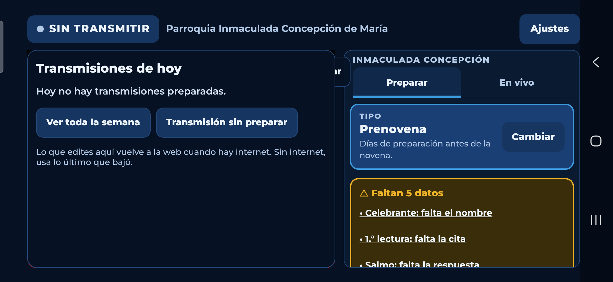
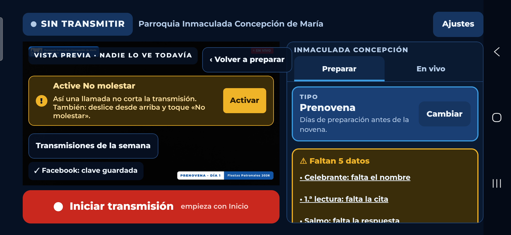

# Cómo transmitir la misa con el celular

Guía para el voluntario. La app se llama **Parroquia en vivo** y transmite a la página de Facebook de la
parroquia, con los rótulos y las pantallas de la parroquia encima del video.

**Si algo no anda, llame a la Pastoral de Comunicaciones:** ______________________

## Antes de la misa (15 minutos antes)

- ☐ **Ponga el celular en el trípode, en horizontal (acostado)**, apuntando al altar.
- ☐ **Conéctelo a un cargador de pared**, no a una computadora. Conectado a una computadora la batería baja
  igual.
- ☐ **Quítele la funda** y déjelo **fuera del sol**. Así no se calienta.
- ☐ Revise que tenga **internet**: wifi de la parroquia o datos móviles.
- ☐ Abra **Parroquia en vivo**. La primera vez pide su correo y su contraseña (los da la Pastoral de
  Comunicaciones); después, elija la parroquia en la lista. Las veces siguientes abre sola, también sin
  internet.
- ☐ La app abre con el celular parado, en **Preparar**. Arriba se ve cómo va a salir; nadie lo ve todavía.
  Toque **Listo · girar para transmitir** y ponga el celular **acostado**.

  

- ☐ Aparece **Transmisiones de hoy**.
  - Si ve la misa de ahora en la lista, toque **Usar esta**.
  - Si dice «Hoy no hay transmisiones preparadas» (como en la imagen), toque **Transmisión sin preparar** y
    llene los datos en el paso siguiente.

  

- ☐ En el panel de la derecha, pestaña **Preparar**, mire el recuadro amarillo **«Faltan N datos»**. Toque
  cada línea y escriba lo que pide (celebrante, cita de la lectura, respuesta del salmo). Cuando diga
  **Todo listo**, siga.
- ☐ Si aparece **Active No molestar**, toque **Activar**. Si se abre una pantalla del celular, encienda
  **No molestar** y vuelva a la app con el botón Atrás. Así una llamada no corta la transmisión.
- ☐ Revise que diga **✓ Facebook: clave guardada**. Si dice **Falta la clave de Facebook** y el botón rojo está
  apagado, no toque nada más: llame a la Pastoral de Comunicaciones.

  

Si toca algo por error antes de iniciar, **‹ Volver a preparar** lo devuelve a la pantalla parada.

## Durante la misa

1. Toque **Iniciar transmisión**. Arriba dice **CONECTANDO…** y después **EN VIVO**, con el reloj avanzando:
   eso significa que va bien.
   - Al empezar, la gente ve la pantalla de bienvenida («En breve comenzamos»). Puede quedar así hasta que
     empiece la misa.
   - Pida a alguien que confirme en Facebook que **se ve y se escucha**.
2. Cuando empieza la misa, toque **Cámara** en la tira de escenas.
3. En el panel, pestaña **En vivo**, toque el botón grande **Siguiente: …** para mostrar el rótulo que sigue
   (lecturas, salmo…). Se quita solo, según lo que diga **Ocultar solo después de**; para quitarlo antes,
   toque **Ocultar**. Si dice **Sin rótulos**, no queda nada por mostrar.
   - Los rótulos se ven solo en la escena **Cámara**. Si desaparece el video de la cámara, toque **Cámara** en
     la tira de escenas.
4. Para acercar la imagen toque **+**; para alejarla, **−**; **1×** vuelve al tamaño normal.
   - **No toque «Pantalla completa»**: esconde el botón Terminar. Si lo tocó, toque **Salir**.
5. **No cierre la app ni apague la pantalla.** La pantalla queda prendida sola.

### Si aparece un aviso

| Aviso | Qué hacer |
|---|---|
| **Señal débil: reconectando…** | Nada. No cierre la app: sigue sola cuando vuelve la señal. |
| **Sin internet** | Revise el wifi o los datos. |
| **Batería 15 %** (o menos) | Conecte el cargador. |
| **El celular está caliente** (amarillo) | Sáquelo del sol o quítele la funda. Se puede seguir. |
| **El celular está muy caliente** (rojo) | Póngalo a la sombra, sin funda y en un cargador de pared. Si sigue igual, termine con **Terminar** y avise. |

### Si la transmisión se corta

Si arriba deja de decir **EN VIVO** y vuelve el botón rojo **Iniciar transmisión** con un mensaje:

1. Revise el wifi o los datos.
2. Toque **Iniciar transmisión** otra vez.
3. Si en dos intentos no vuelve, llame a la Pastoral de Comunicaciones.

Si se queda en **CONECTANDO…** mucho tiempo, toque **Cancelar** y pruebe otra vez.

## Al terminar

1. Toque **Terminar** (arriba a la derecha).
2. Toque **Mostrar «Gracias» y terminar en 10 s**. La gente ve la pantalla de Gracias y la transmisión
   termina sola.
   - **Terminar ahora** corta en el momento. **Seguir transmitiendo** vuelve atrás.
3. Cuando dice **La transmisión terminó.**, ya puede desconectar el celular.
   - Si dice **El celular tardó en cerrar la transmisión**, abra Facebook y revise que ya no esté en vivo. Si
     sigue en vivo, avise a la Pastoral.

## Si algo falla

- **La cámara no está lista** o **Hace falta permiso de cámara y micrófono**: toque **Reintentar** y acepte el
  permiso. Si sigue, cierre la app (botón de las tres rayas abajo, deslice **Parroquia en vivo** hacia arriba)
  y ábrala de nuevo. Si tampoco, llame a la Pastoral.
- **Después de una transmisión con problemas**: en **Ajustes**, toque **Compartir registro** y mándelo a la
  Pastoral de Comunicaciones. Así se puede ver qué pasó.
